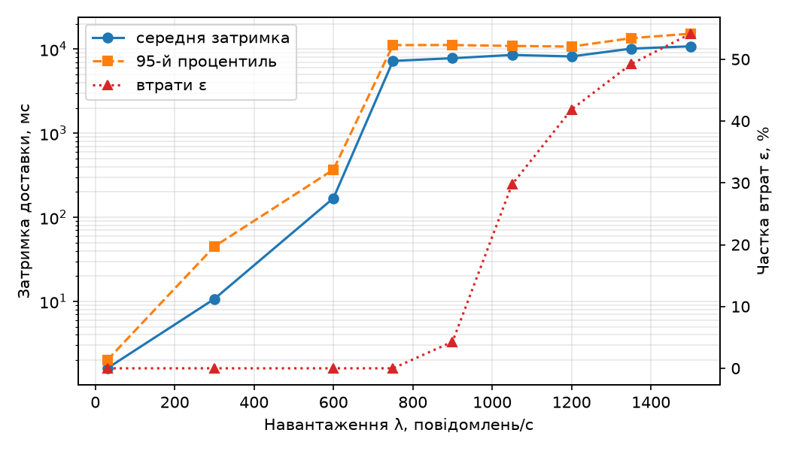

# Розгортання edge–cloud PerimeterGuard

Документ описує розподілене розгортання системи: складники, шаблони проєктування, експеримент із розривом зв’язку, навантажувальне випробування та висновки щодо масштабованості, мови й технологічного стека.

## Складники

Систему я розділив на периферійний і серверний складники (рис. 1 методичних
вказівок). Периферійний складник працює у вузлі ділянки периметра: емулятор
сенсорів, брокер периферії та шлюз. Серверний складник — брокер і підписник
сервера об’єкта. Описано все в `smart/docker-compose.yml`; мереж Docker дві,
`edge` і `cloud`, і лише шлюз підключено до обох, тобто він є єдиним зв’язком
периферії із сервером.

| Сервіс | Складник | Мережі | Ресурси | Том (дані) | Призначення |
|---|---|---|---|---|---|
| `sensors` | периферія | edge | — | `sensors-data` | емулятор: рух, освітленість, стан воріт; номер запуску `boot` |
| `edge-broker` | периферія | edge | `cpus: 0.5`, `mem_limit: 128m` | — | брокер MQTT вузла; недоступний з хоста |
| `gateway` | периферія | edge, cloud | `cpus: 0.25`, `mem_limit: 128m` | `edge-data` | буфер `outbox` у SQLite, пересилання з QoS 1, видалення після PUBACK |
| `cloud-broker` | сервер | cloud | — | — | брокер сервера; порт `127.0.0.1:1883` лише з цього комп’ютера |
| `collector` | сервер | cloud | — | `cloud-data` | підписник: перевірка схеми, `readings`, `anomalies`, `rejected` |

Ліміти периферії (`cpus: 0.25`, `mem_limit: 128m` для шлюзу) я взяв з міркувань
подання розгортання ЛР 1: вузол біля камери має вкластися у вузький енергетичний
бюджет (NFR-05, 15 Вт), тому процесор шлюзу я обмежив свідомо. Образ спільний для
Python-складників (`smart/Dockerfile`, `python:3.14-slim`, `paho-mqtt==2.1.0`).
Брокер опубліковано лише на `127.0.0.1`, бо в конфігурації дозволено анонімний
доступ (`smart/broker/mosquitto.conf`); параметр `set_tcp_nodelay true` вимикає
алгоритм Нейгла, щоб підтвердження PUBACK надсилалися одразу.

Після `docker compose up -d --build` сервісів у стані Up — 5 (очікується п’ять). Журнал шлюзу: буфер=1, відкинуто=0, зв’язок=так. Підсумок підписника для запуску boot 1: λ ≈ 3,0 повідомлень/с, loss = 0.

## Шаблони

Я застосував два шаблони: «публікація — підписка» і «буферизація на периферії».

### Публікація — підписка

- **Контекст.** Вузол ділянки периметра публікує телеметрію трьох сенсорів; споживачів (підписник сервера, аналітика, оператор) може бути кілька, і їх набір змінюватиметься.
- **Задача.** Додавати нових споживачів без змін сенсорів і без втручання в наявного підписника.
- **Сили.** Сенсори не повинні знати про підписників; стан пристрою потрібен новому споживачеві одразу (FR-10); телеметрія коротка й частота висока.
- **Розв’язок.** Теми `p1/north/<пристрій>/tele`, підписка із символом `+`; стан пристрою — збережене повідомлення `online` і заповіт `offline`.
- **Наслідки.** Плюс: нового підписника додано командою `mosquitto_sub` без змін `sensors.py` і `collector.py` (експеримент нижче). Мінус: брокер не зберігає історії для підписників, що з’явилися пізніше, а стан «хто підписаний» невидимий видавцям.

Експеримент: два додаткові підписники, `mosquitto_sub`, без змін сенсорів і `collector.py`. На сервері отримано 3 повідомлення телеметрії; на периферії — 3 рядки стану `online`, які брокер надіслав новому підписникові одразу (збережені повідомлення), далі до кінця очікування нових повідомлень стану не було («Timed out»).

### Буферизація на периферії (store-and-forward)

- **Контекст.** Ланка між вузлом периметра й сервером — одна, і її розрив для розподіленої системи є нормальним режимом (QS-02 ЛР 1).
- **Задача.** Пережити розрив без втрати показів.
- **Сили.** Підтверджені тривоги не можна губити (ADR-0003); процесор шлюзу обмежений (`cpus: 0.25`); нові покази не зупиняються під час розриву.
- **Розв’язок.** `gateway.py` записує кожне повідомлення в буфер `outbox` (SQLite, WAL) до надсилання, надсилає найстаріші записи з QoS 1 і видаляє їх лише після PUBACK. Місткість — 50000 записів, переповнений буфер відкидає найстаріші.
- **Розрахунок місткості** за V_буф = r · s · T_розр: 50000 записів — це 4,6 год розриву за номінальних 3 повідомлень/с і 56 хв за піку 15 повідомлень/с; за s ≈ 131 байтів V_буф ≈ 6,5 МБ.
- **Наслідки.** Плюс: Q₀ = 19240 записів, loss = 0, час вивантаження ≈ 46 с проти розрахункових 29 с. Мінус: після розриву з’являються дублікати (QoS 1 — «щонайменше один раз»), тож підписник має бути ідемпотентним (первинний ключ `(dev, boot, seq)`); у режимі `synchronous=NORMAL` після вимкнення живлення останні транзакції буфера можуть відкотитися; Python-шлюз споживає процесор у межах ліміту.

Третій шаблон, «кероване зниження якості», я не реалізовував; це позначено як можливе розширення (див. «Масштабованість»).

## Розрив зв’язку

Розрив і відновлення зв’язку я виконав командами `docker network disconnect/connect` для шлюзу (розрив тривав 61 с) за інтенсивності потоку λ ≈ 300 повідомлень/с.

- Шлюз помітив розрив через 19 с (очікування: два інтервали Keep Alive по 10 с: перевірка з’єднання й очікування відповіді).
- Буфер зростав приблизно на 311 записів/с (λ = 300), максимум Q₀ = 19240 записів.
- Лічильник «відкинуто» шлюзу наприкінці: 0 (місткість буфера 50000 записів не вичерпано).
- За формулою T_розв = Q₀ / (μ₁ − λ), μ₁ = 10⁶ / (8 · 131) ≈ 954 повідомлень/с: 19240 / (954 − 300) ≈ 29 с; виміряно ≈ 46 с (від відновлення зв’язку до спорожнення буфера, крок журналу 2 с).
- Швидкість вивантаження за журналом μ₁ ≈ 725 повідомлень/с (розрахунок 954).
- Підсумок підписника (запуск boot 2): N_над = 42225, N_отр = 42225, loss = 0, дублікатів 100, позачергових 0; найбільша затримка 64,2 с — у показів з початку розриву.

Утрат даних немає (loss = 0): буферизація на периферії пережила розрив. Дублікати з’явилися, бо шлюз повторно надіслав записи, на які не надійшов PUBACK (QoS 1 — «щонайменше один раз»), і підписник їх відкинув.

## Навантаження

Навантажувальне випробування я виконав скриптом `smart/loadtest.sh`: частота кожного з трьох
сенсорів зростає ступенями по 30 с (HZ = 10, 100, 200, 250, 300, 350, 400, 450, 500), буфер шлюзу зменшено до 10000 записів,
після ступеня скрипт чекає спорожнення буфера. Кожен ступінь — окремий запуск емулятора, тобто окремий рядок у
`results/load.csv`. Графік будує `smart/plot.py` (рисунок нижче).

| λ, повід./с | N_над | N_отр | ε | L_д сер., мс | p95, мс | max, мс | u = λ/Θ |
|---:|---:|---:|---:|---:|---:|---:|---:|
| 30 | 900 | 900 | 0,000 | 1,6 | 2 | 35 | 0,03 |
| 300 | 9000 | 9000 | 0,000 | 10,7 | 45 | 167 | 0,34 |
| 600 | 18000 | 18000 | 0,000 | 169 | 369 | 540 | 0,68 |
| 750 | 22500 | 22500 | 0,000 | 7240 | 11162 | 11429 | 0,85 |
| 900 | 27000 | 25842 | 0,043 | 7790 | 11188 | 11374 | 1,02 |
| 1050 | 31500 | 22133 | 0,297 | 8522 | 10899 | 11080 | 1,19 |
| 1200 | 36000 | 20924 | 0,419 | 8182 | 10721 | 11014 | 1,36 |
| 1350 | 40500 | 20568 | 0,492 | 10129 | 13485 | 13807 | 1,54 |
| 1500 | 45000 | 20635 | 0,541 | 10798 | 15270 | 15709 | 1,71 |

*Рис. 1 — Залежність затримки доставки та частки втрат від навантаження λ (`results/latency.png`).*

**Θ ≈ 879 повідомлень/с**. Θ визначаю за найбільшою затримкою на ступенях із втратами: переповнений буфер
10000 записів вичерпується за 10000 / Θ секунд, тож Θ ≈ 10000 / L_max. До u ≈ 0,5 середня затримка становить 6,1 мс (одиниці–десятки мілісекунд). Поблизу Θ середня затримка різко зростає, як у
моделі M/M/1, W = 1 / (μ − λ): за u → 1 знаменник прямує до нуля. За λ > Θ черга зростає на λ − Θ повідомлень щосекунди, а найбільшу
затримку обмежує місткість буфера. Найвище навантаження, за якого p95 ≤ 400 мс (бюджет L_мер із NFR-01) і втрат немає: λ ≈ 600 повідомлень/с.

- λ = 900: розрахункові втрати (λ − Θ) · 30 − 10000 ≈ 0, виміряно 1158.
- λ = 1050: розрахункові втрати (λ − Θ) · 30 − 10000 ≈ 0, виміряно 9367.
- λ = 1200: розрахункові втрати (λ − Θ) · 30 − 10000 ≈ 0, виміряно 15076.
- λ = 1350: розрахункові втрати (λ − Θ) · 30 − 10000 ≈ 4124, виміряно 19932.
- λ = 1500: розрахункові втрати (λ − Θ) · 30 − 10000 ≈ 8627, виміряно 24365.

Лічильник «відкинуто» шлюзу (69898) дорівнює сумі втрат, які виявив підписник (69898).

**Вузьке місце.** За `docker stats` (знімок у середині кожного ступеня; піки): cloud-broker — 4,2 % CPU, 3,7 МіБ, collector — 10,7 % CPU, 22,7 МіБ, edge-broker — 10,5 % CPU, 4,1 МіБ, gateway — 26,2 % CPU, 25,0 МіБ, sensors — 39,2 % CPU, 16,5 МіБ. Контейнер `gateway` працював на межі свого ліміту: 26,2 % при ліміті 25 % ядра (на ступені HZ = 250). Виміряна Θ ≈ 879 повідомлень/с збігається з розрахунком для смуги ланки (10⁶ / (8 · 131) ≈ 954): **вузьке місце — ланка периферія — сервер** (модельна смуга 1000 кбіт/с), яку шлюз вичерпує повністю.

Найбільша затримка на графіку — 15,7 с при λ = 1500 повід./с. Повторні прогони ступенів поблизу Θ чутливі до інших програм на комп’ютері, тож числа залежать від машини.

## Масштабованість

**Яке навантаження потрібне системі.** За нефункційними вимогами ЛР 1 (NFR-02) система має працювати з 8 до 64 камер.
Кожен вузол ділянки має три сенсори; частоту я беру з табл. 4 методичних вказівок (1–5 Гц): номінально 1 Гц дає
λ_вузла = 3 повідомлень/с, у піку (5 Гц) — 15 повідомлень/с. Для 64 вузлів серверний складник отримує
192 повідомлень/с номінально й 960 повідомлень/с у піку.

**Який запас дає Θ.** Θ (виміряна) ≈ 879 повідомлень/с для одного вузла (одна ланка зі смугою 1000 кбіт/с).
Запас вузла за номінального потоку — у 293 разів, у піку — у 59 разів, тож один вузол масштабувати не треба.
На сервері потоки всіх вузлів сходяться в одну точку: пік 960 повід./с становить 109 % від Θ (1,09); номінальні 192 — 22 %.
Θ вимірювалась для ланки одного вузла, а окремої ємності серверного підписника я не вимірював: у випробуванні втрати давав буфер шлюзу,
а підписник на ступенях нижче Θ тримав затримку невеликою, тому вважаю, що його ємність не нижча за виміряну Θ. Це припущення потрібно перевірити
окремим тестом без обмеження смуги (наступний крок).

**Що масштабувати першим і як.** Першим доведеться масштабувати: серверний підписник і брокер. Спосіб — горизонтально: кілька підписників із розбиттям стану за темами (за ділянками `p1/<ділянка>/…`), брокер — вертикально або кластером; вертикальне масштабування одного підписника швидко впирається в SQLite без сервера.

**Додатково.** Якби потік перевищив Θ, корисним було б «кероване зниження якості» (шлюз переходить на хвилинні агрегати, події не відкидаються);
я його не реалізовував, але воно з’єднується з вимогою ЛР 1 про незмінну доставку підтверджених тривог.

## Мова і стек

| Складник | Вимоги, що визначають вибір | У моїй реалізації | Обґрунтування та альтернатива |
|---|---|---|---|
| Сенсори | на пристрої — сотні кілобайтів пам’яті й енергія | Python — лише емулятор | для вбудованого ПЗ — C або Rust: без збирача сміття, передбачувані час і пам’ять |
| Брокер периферії | мала пам’ять, автономність вузла | Eclipse Mosquitto 2 (C), 4,1 МіБ пам’яті | легкий брокер без залежностей; міст Mosquitto міг би замінити шлюз, але не керує місткістю й переповненням буфера |
| Шлюз | безперервна робота, буфер на диску, обмежений процесор (NFR-05) | Python, paho-mqtt, SQLite; 25,0 МіБ пам’яті; Θ ≈ 879 повід./с за `cpus: 0.25` | у 59 разів більше за піковий потік вузла (15 повід./с). Для багатьох вузлів на слабкому обладнанні — Go: компільований, менше пам’яті, прості горутини |
| Серверний брокер | багато вузлів і незалежні підписники | Eclipse Mosquitto 2, 3,7 МіБ пам’яті | не зберігає історії; якщо потрібне повторне читання історії подій — Apache Kafka |
| Підписник і сховище | перевірка схеми, ідемпотентний запис | Python, SQLite, 22,7 МіБ пам’яті | один файл без сервера — достатньо для одного об’єкта; для 64 вузлів — сховище часових рядів і кілька підписників із розбиттям за темами |

Остаточне рішення для найважливішого складника, шлюзу, я зафіксував в `docs/adr/0006-mova-ta-tekhnolohichnyi-stek.md`.
